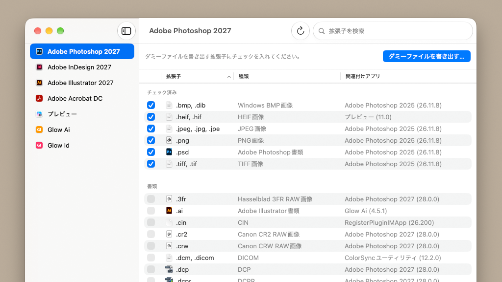

# Default Apps

macOS用デスクトップアプリ

## ダウンロード

[Default-Apps-201.zip](https://github.com/monokano/Default-Apps/releases/download/2.0.1/Default-Apps-201.zip)
 [更新内容](https://github.com/monokano/Default-Apps/releases)

## 用途

ファイルの関連付けを補助するユーティリティアプリです。

- 拡張子の関連付けの状態をアプリごとに確認
- Finderで関連付けを設定しやすくするためのダミーファイルを書き出し

**注意：Default Appsに関連付けの機能はありません。できることは確認とダミーファイルの書き出しまでです。**

## 使い方

### 前準備

1. Default Appsのサイドバーに、関連付けを確認したいアプリ（.app）をドロップする（または＋ボタンで追加する）
2. サイドバーでアプリを選択。そのアプリが対応している拡張子のリストが表示される

### 拡張子の関連付けの状態を確認

1. リストで関連付けを確認したい拡張子のチェックボックスをONにする
2. 更新ボタンを押す
3. チェックボックスをONにした拡張子がリストの上にまとまる
4. リストの「関連付けアプリ」の列で現在の状態を確認する

Default Appsを終了しても、チェックの状態は次回起動時に引き継がれます。

### ダミーファイルの書き出し

チェックボックスをONにした拡張子をダミーファイル（空ファイル）で書き出します。

1. 「ダミーファイルを書き出す…」ボタンを押す
2. 保存場所を選択する（デフォルトはデスクトップ）
3. 「書き出す」ボタンを押す

チェックボックスをONにした拡張子が2つ以上なら「ダミーファイル」フォルダの中に書き出されます。

#### Finderで関連付けを設定する

1. 書き出したダミーファイルをすべて選択する
2. **「opt+cmd+I」のキーを押す**
3. 情報ウインドウが1つだけ表示される
4. 「このアプリケーションで開く」のポップアップボタンで、関連付けしたいアプリを選ぶ
5. 「すべてを変更…」ボタンを押す
6. 確認のダイアログが表示されるので「続ける」ボタンを押す

Default Appsに戻り、更新ボタンを押して、関連付けアプリが変わったことを確認します。

### Default Appsに関連付けの機能がない理由

macOS Tahoe 26.4から、関連付けの設定はFinderでの手動操作に制限されました。Default Appsに関連付けの機能を実装しても、期待通りの結果にはなりません。そのため、Finderで手動操作をするためのダミーファイルを書き出すようにしています。

## 動作環境

macOS 13.5 Ventura 以降（Universal Binary）

## ライセンス

This project is licensed under the MIT License - see the [LICENSE](LICENSE) file for details.
